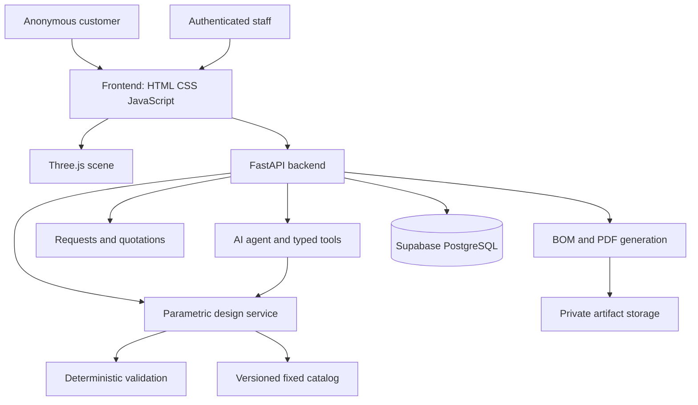

# Product Requirements Document (PRD)
## AI-Powered Wardrobe Configurator for a Carpentry Business

**Status:** Product scope approved; implementation details pending where indicated  
**Version:** 1.0  
**Release:** Full, phased MVP  
**Audience:** Product owner, carpentry specialists, software developers, AI coding agents (Claude Code / Cursor)

---

## 1. Product overview

Build a web application that enables customers to independently design a custom wardrobe, visualize it in interactive 3D, receive assistance from an AI design agent, and submit a detailed technical design package to a carpentry business for a quotation. The carpentry staff can review and modify submitted designs, manage revisions, and manually prepare and send quotations.

The product is a design-to-quotation platform, not an automated manufacturing or e-commerce system. The customer-facing experience requires no account. The application must distinguish between a design that passes configured software rules and a design that has been professionally approved for manufacturing.

### 1.1 Objectives

- Reduce the friction of communicating customer requirements to the carpentry business.
- Enable customers to explore wardrobe configurations without CAD expertise.
- Provide accurate, synchronized, interactive 3D visualization based on structured design data.
- Use AI to assist with design decisions and execute approved changes, rather than merely answer questions.
- Prevent invalid configurations through deterministic manufacturing rules.
- Deliver actionable technical documentation and a reusable design to carpentry staff.

### 1.2 Approved decision register

| ID | Decision | Approved scope |
|---|---|---|
| 01 | B | Design, interactive 3D and AI assistance, followed by a request for quotation. |
| 02 | B | Hinged-door and sliding-door wardrobes. |
| 03 | D | Templates, manual drag-and-drop and AI-driven design in one editor. |
| 04 | E | Full customization: dimensions, interior, materials, exterior and accessories. |
| 05 | A+B | Interactive 3D, zoom, rotation, live updates, door/drawer interaction and door hiding. |
| 06 | D | Advanced AI design agent with alternatives, explicit approval and undo. |
| 07 | D | Deterministic professional rule engine with AI explanations and proposed corrections. |
| 08 | A | Manual entry of width, height and depth. |
| 09 | A | Fixed, code-defined catalog; no catalog administration interface. |
| 10 | A | No customer registration; contact details collected upon submission. |
| 11 | C | Technical design package, editable model, images, BOM, component dimensions, validation results and PDF. |
| 12 | C | Authenticated staff dashboard, request management, editing, versioning, AI, notes and manual quotations. |
| 13 | A | Python, FastAPI, HTML, CSS, JavaScript, Three.js, Supabase and Railway. |
| 14 | C | Separate frontend/backend; Git dev/main; Railway development/production; separate data and secrets. |
| 15 | C | Full MVP delivered in ordered implementation phases. |

### 1.3 Scope exclusions

The following are not part of the approved MVP: customer accounts or customer portals; automatic price calculation; checkout, payment, order fulfillment, production scheduling or installation tracking; full CRM, stock, supplier or procurement management; dynamic catalog administration; room scanning, LiDAR, photo analysis, AR, photorealistic room rendering or dedicated 2D CAD views; corner wardrobes, walk-in closets, kitchens and other carpentry products; automated CNC export or manufacturing approval. Technical dimensions and documentation remain required even though a dedicated 2D CAD viewer is excluded.

## 2. Users and permissions

| Actor | Permitted actions |
|---|---|
| Anonymous customer | Start a design, customize it, use AI, approve or reject proposed changes, undo changes, preview 3D, submit contact details and a quotation request. |
| Authenticated carpentry staff | Access requests and contact details; inspect and edit designs; manage versions, internal notes and request status; use AI; download technical documents; manually create and send quotations. |

A separate administrative role hierarchy is not approved. Staff authorization must be enforced server-side. Anonymous customers must not be able to enumerate or retrieve other customers' submitted requests. Persistent cross-device customer drafts are not required; temporary draft/session handling is a recommended implementation detail.

## 3. Core user journeys

### 3.1 Customer design journey

1. Open the application without registration.
2. Select a hinged-door or sliding-door wardrobe and manually enter width, height and depth.
3. Start with an empty wardrobe, choose a predefined template, or ask the AI agent to generate a design.
4. Customize the wardrobe through form controls, drag-and-drop and/or conversation.
5. Inspect the live 3D model, rotate and zoom, open and close doors and drawers, and hide doors to inspect the interior.
6. Resolve invalid configuration issues with manual edits or AI-assisted proposals.
7. Review the final design, provide name, telephone, email and any additional requirements, and submit a quotation request.
8. Receive a clear submission confirmation. No price or production commitment is implied.

### 3.2 AI-assisted design journey

1. Customer describes needs or requests a modification.
2. Agent reads the current structured design, available catalog and relevant constraints.
3. Agent asks clarifying questions when necessary and prepares one or more candidate changes.
4. The deterministic engine validates candidates. The UI presents the proposed changes and relevant issues without committing them.
5. Customer accepts or rejects a proposal. Acceptance triggers server-side revalidation and atomic application to the current design version.
6. The editor and 3D view refresh from the same updated design. The customer can undo an applied change.

### 3.3 Staff journey

1. Authenticate and open the requests dashboard.
2. Select a request and inspect contact information, original customer design, 3D model, technical package and validation results.
3. Review feasibility and make necessary edits manually or with AI assistance.
4. Save a new version without overwriting the original submitted design.
5. Add internal notes, update the request status, and manually prepare a quotation linked to the relevant design version.
6. Send the quotation through the selected delivery mechanism and record its outcome. The delivery channel remains an open decision.

## 4. Functional requirements

All requirements in this section implement the approved scope unless explicitly labeled as recommendations.

### FR-01 — Wardrobe dimensions and types

- Support straight hinged-door and sliding-door wardrobes.
- Accept customer-entered width, height and depth.
- Allow dimensions and door count to be changed in the editor, subject to validation.
- Show clear units, validation messages and the effects of dimension changes on components.
- Do not infer measurements from images or scan the room.

### FR-02 — Hybrid design editor

- Provide predefined templates, an empty starting configuration and AI-generated starting designs.
- Allow manual placement and modification of shelves, drawers, vertical partitions, hanging rods, compartments and doors using drag-and-drop and suitable input controls.
- Allow changes to component positions, counts and dimensions within supported constraints.
- Support switching between manual, template-based and AI-assisted design without losing the current configuration.
- Support materials, wood types, colors, textures, finishes, handles, mirrors and compatible door types.
- Support catalog-defined accessories such as LED lighting, shoe racks, trouser racks and soft-close mechanisms, subject to actual catalog availability.
- Display validation feedback before invalid modifications are committed.

### FR-03 — Interactive 3D visualization

- Render the wardrobe from the canonical parametric model using Three.js.
- Provide 360-degree orbit, zoom and real-time updates after accepted changes.
- Render dimensions and component relationships consistently with the underlying model.
- Animate opening and closing of hinged/sliding doors and drawers according to supported mechanisms.
- Allow doors to be hidden to inspect the interior.
- Apply selected visual materials, colors and textures.
- Capture design images for the technical package.
- Keep visual-only camera and animation state separate from manufacturing geometry.
- Do not require photorealistic rendering or room placement.

### FR-04 — Fixed catalog

- Store supported material, component, finish, template and accessory definitions in version-controlled application code or configuration files.
- Include technical attributes and compatibility metadata required by the rule engine.
- Use the same catalog for manual editing, AI tools, validation, rendering and BOM generation.
- Catalog changes require a developer update and deployment; no staff-facing catalog editor is included.
- Preserve or reference catalog versions so that historical submitted designs remain interpretable.

### FR-05 — Deterministic validation engine

- Validate overall dimensions, component bounds, collisions, spacing, door compatibility and hardware constraints.
- Evaluate configured material thickness, allowed panel spans, load limits, drawer and opening mechanisms, and other professional constraints provided by the business.
- Run validation for manual changes, AI proposals, staff edits and final submission.
- Return machine-readable rule identifiers, affected components and human-readable explanations.
- Block changes violating hard constraints; distinguish warnings from blocking errors where the business defines such a distinction.
- Revalidate on the backend before committing or submitting a design; frontend checks alone are insufficient.
- AI may explain errors and suggest corrections, but must not override deterministic rules.
- Never represent successful validation as a guarantee of manufacturing feasibility. Professional review is required.

### FR-06 — AI design agent

- Answer relevant questions about wardrobe configuration, materials and storage needs.
- Understand the current design through structured state, not screenshots alone.
- Ask clarifying questions rather than invent customer dimensions or unsupported materials.
- Generate complete initial designs, alternative configurations and proposed edits.
- Identify potential design issues based on deterministic validation and recommend corrections.
- Present proposed changes before application and require explicit user approval for each committed AI change or batch.
- Support rejection and undo; an AI proposal must not silently mutate the design.
- Operate in both the customer editor and staff editor, subject to authorization.
- Restrict tool calls to supported catalog items and validated design operations.
- Provider failures must leave the manual editor functional and preserve existing design state.

### FR-07 — Quotation request and technical package

- Collect customer name, telephone, email, final wardrobe configuration and any textual requirements at submission.
- Store a versioned snapshot of the submitted design and its validation results.
- Provide 3D preview images, overall and component dimensions, interior layout, material and accessory selections.
- Generate a bill of materials (BOM) from the canonical design, not from free-form AI output.
- Generate a downloadable PDF summary and associate it with the exact submitted design version.
- Make the structured design available for staff inspection and editing.
- Prevent invalid designs from being submitted as valid quotation requests. If generation or persistence fails, report the actual failure and permit a safe retry.
- Mark the package as preliminary and subject to professional review; the BOM is not automatically a certified cutting list.

### FR-08 — Staff dashboard

- Require authenticated staff access.
- List quotation requests and their current statuses.
- Show request contact details, original design, 3D preview, technical documents and validation output.
- Allow staff to modify designs, invoke the AI agent, save revisions and inspect version history.
- Preserve original customer submissions and previously issued quotation references.
- Allow internal professional notes and status updates.
- Allow manual quotation entry and delivery to customers.
- Provide download access to associated PDF and technical artifacts.

## 5. Parametric design engine

### 5.1 Canonical model

The canonical structured design is the single source of truth for rendering, editing, validation, AI tool calls and documentation. Three.js meshes must be derived from this model; do not use mesh geometry as the sole persistent representation.

The following structure is a recommended implementation contract, not a finalized manufacturing schema:

```json
{
  "schema_version": 1,
  "design_id": "uuid",
  "revision": 1,
  "wardrobe_type": "hinged",
  "dimensions_mm": {"width": 1800, "height": 2400, "depth": 600},
  "catalog_version": "example-v1",
  "components": [],
  "material_selections": {},
  "accessories": [],
  "door_configuration": {}
}
```

Example dimensions are illustrative, not approved production limits. A component should have a stable ID, type, parent/compartment reference where relevant, position, dimensions, catalog reference and applicable configuration parameters. Use a documented coordinate convention and a consistent unit system (integer millimeters recommended). Derive physical board dimensions and BOM entries using approved construction rules, including material thickness and relevant clearances. Never guess manufacturing tolerances.

### 5.2 State transitions

Recommended operation flow:

```text
Manual edit or AI proposal
  -> Typed design operation
  -> Construct candidate state
  -> Deterministic validation
  -> Approval (for AI proposals)
  -> Revision check and server-side validation
  -> Commit valid state
  -> Update editor and Three.js scene
  -> Regenerate derived data when required
```

Use version checks to reject stale proposals and concurrent edits. Undo must restore a valid prior design state. Preserve saved versions and invalidate derived artifacts when their source revision changes.

### 5.3 Suggested AI tool contracts

| Tool | Purpose |
|---|---|
| `get_design_state` | Read current structured design and revision. |
| `get_catalog` | Read supported materials, components and constraints. |
| `validate_design` | Validate a proposed candidate without mutation. |
| `propose_design` | Produce a complete candidate wardrobe. |
| `propose_operations` | Produce typed edits such as adding shelves or resizing compartments. |
| `compare_designs` | Summarize differences between alternatives. |

The application, not the language model, authorizes and commits approved operations. Tool naming and implementation are recommendations. MCP and a particular agent framework are not approved requirements.

## 6. UX/UI requirements

The approved interaction model is a hybrid editor with manual controls, interactive 3D and AI assistance. The following screen layout is recommended rather than mandated:

- Entry/start screen: select wardrobe type, dimensions and starting method.
- Configurator: component/template catalog, central 3D viewport, selected component properties and AI conversation panel.
- Proposal review: show the scope of proposed changes, affected components, validation status and explicit accept/reject controls.
- Submission screen: design summary, contact form and quotation request action.
- Staff sign-in, request list, request detail/editor, version history and manual quotation screen.

Use clear labels, immediate validation feedback, meaningful loading/error states and accessible non-drag controls for core editing actions. Responsive behavior and mobile interaction design should be tested; no specific device matrix or visual brand has been approved. Interface language and RTL requirements are pending product confirmation.

## 7. System architecture

### 7.1 Approved technology stack

| Layer | Approved technology |
|---|---|
| Frontend | HTML, CSS, vanilla JavaScript |
| 3D engine | Three.js |
| Backend | Python, FastAPI |
| Database | Supabase (PostgreSQL) |
| Deployment | Railway |
| Version control | GitHub |

Recommended supporting choices: Supabase Auth for staff, private Supabase Storage for artifacts, Pydantic for API schemas, a PDF library selected after language/font requirements are confirmed, and an LLM provider abstraction. These supporting choices are not final approvals. Do not introduce React, Next.js, Redis, microservices or paid AI providers as mandatory dependencies without approval.

### 7.2 Logical architecture



Recommended modular monolith: keep business logic in domain services rather than route handlers; use modular JavaScript for editor state, scene rendering, component controls, API client and AI proposal handling. Keep AI credentials and privileged database access on the backend.

### 7.3 Proposed repository structure

```text
repository/
  frontend/
    index.html
    assets/
    css/
    js/
      api/
      editor/
      state/
      three/
      ai/
      staff/
  backend/
    app/
      main.py
      api/
      core/
      domain/
      services/
      catalog/
      ai/
      schemas/
      repositories/
    migrations/
    tests/
  PRD.md
  README.md
  .gitignore
```

This structure is illustrative. Separate frontend and backend directories are approved; the internal directory layout may be refined during implementation.

## 8. Proposed data model

The following is a recommended logical schema to implement the approved workflows. Exact SQL definitions, retention and indexes require implementation review.

| Entity | Key fields / responsibilities |
|---|---|
| `staff_profiles` | ID, authentication subject, active state, display name. |
| `designs` | ID, creation time, current version reference; anonymous-session ownership where needed. |
| `design_versions` | ID, design ID, revision, structured design JSON, schema/catalog/rule version, author context, timestamp. |
| `quotation_requests` | ID, original design version ID, name, telephone, email, customer notes, status, timestamps. |
| `validation_results` | ID, design version ID, rule version, result, structured issues, timestamp. |
| `design_artifacts` | ID, design version ID, kind (PDF, image, BOM), private storage reference, timestamp. |
| `staff_notes` | ID, request ID, staff ID, note, timestamp. |
| `quotations` | ID, request ID, design version ID, manually entered price and commercial details, status, delivery metadata. |
| `ai_proposals` | ID, design/session reference, base revision, candidate or operations, approval state, timestamps; persistence policy to be confirmed. |

Relationships: one design has many versions; each request references the immutable submitted version; validation records and artifacts refer to exact versions; a request may have multiple notes and quotations. Keep the catalog in code, not in an editable database catalog. Use database constraints and transactions to maintain consistency. A quotation must reference the version on which its price is based.

Recommended statuses for discussion: `new`, `under_review`, `quoted`, `closed`; exact workflow and transitions are not yet approved.

## 9. Proposed REST API

All paths are illustrative implementation recommendations. Use typed request/response schemas, consistent errors and appropriate authorization.

| Method | Endpoint | Purpose |
|---|---|---|
| GET | `/api/catalog` | Retrieve available code-defined catalog items and templates. |
| POST | `/api/designs` | Create a temporary design/session. |
| GET | `/api/designs/{id}` | Retrieve an authorized design. |
| POST | `/api/designs/{id}/validate` | Validate candidate state. |
| POST | `/api/designs/{id}/operations` | Apply validated manual operations. |
| POST | `/api/designs/{id}/undo` | Restore previous valid state. |
| POST | `/api/designs/{id}/ai/proposals` | Generate non-mutating AI proposals. |
| POST | `/api/designs/{id}/ai/proposals/{pid}/approve` | Apply explicitly approved proposal after revision and validation checks. |
| POST | `/api/designs/{id}/ai/proposals/{pid}/reject` | Reject proposal without mutation. |
| POST | `/api/requests` | Submit design snapshot and contact information. |
| GET | `/api/staff/requests` | List requests (staff only). |
| GET | `/api/staff/requests/{id}` | Retrieve full request detail. |
| PATCH | `/api/staff/requests/{id}` | Update approved request fields/status. |
| POST | `/api/staff/requests/{id}/notes` | Add staff note. |
| GET | `/api/staff/designs/{id}/versions` | Inspect version history. |
| GET | `/api/staff/artifacts/{id}` | Access authorized technical artifact. |
| POST | `/api/staff/requests/{id}/quotations` | Create manual quotation. |
| POST | `/api/staff/quotations/{id}/send` | Send quotation through configured delivery mechanism. |

Staff edits may reuse authorized design operations rather than duplicate domain logic. Recommended protections include session ownership, request idempotency, payload limits, revision conflicts and explicit authorization for every artifact access. The quotation sending endpoint must not claim delivery unless the configured provider confirms the relevant outcome.

## 10. Technical documentation and BOM

Generate documentation deterministically from the validated design revision. The PDF must include customer contact details, wardrobe type, overall dimensions, interior layout, selected finishes/materials, accessories, component measurements, preview images, BOM and validation summary. Include design ID/revision, generation timestamp and a professional-review disclaimer. The BOM should contain component identifiers, material/catalog references, quantities and applicable dimensions; hardware and accessory quantities should reflect approved catalog rules.

Use the same model for visual and technical outputs. Board thickness, edge banding, joinery, saw kerf, hardware allowances and other production-specific calculations must only be included when the carpentry business provides and validates those rules. PDF formatting, language, branding and exact BOM granularity remain open decisions. Do not invent cutting specifications or claim CNC readiness.

## 11. Security, privacy and non-functional requirements

Recommended implementation safeguards necessary for the approved workflows:

- Enforce staff authentication and authorization on the server; use least privilege and database access policies such as RLS where applicable.
- Keep AI API keys, Supabase service credentials and delivery credentials out of client code and Git history.
- Use HTTPS, restricted CORS, server-side schema validation, and parameterized database queries or a safe data access layer.
- Protect anonymous drafts with unguessable, scoped session credentials; do not rely on a public design ID alone.
- Rate-limit public AI and submission endpoints; impose request size, token, concurrency and spending limits appropriate to the selected provider.
- Treat customer text and model output as untrusted. Restrict AI tools, validate typed arguments, and prevent prompt injection from bypassing approval or authorization.
- Keep technical files private; issue scoped access only to authorized staff. Minimize personal data sent to AI providers.
- Redact sensitive data from logs and avoid exposing raw exceptions to users.
- Provide graceful handling of API, database, PDF and AI failures; retain the current valid design on failure.
- Keep interactive rendering responsive, avoid rebuilding unrelated meshes unnecessarily, and dispose of unused Three.js resources.
- Record operational errors and security-relevant events. Establish backups and recovery procedures before production.

No quantified latency, availability, retention, accessibility standard, compliance certification or AI spending limit was approved. Establish measurable targets after testing representative designs and receiving business input.

## 12. DevOps and deployment

### 12.1 Mandatory approved topology

- Create one GitHub repository containing separate `frontend/` and `backend/` directories.
- Maintain branches `dev` and `main`.
- Create one Railway project with Development and Production environments.
- Create two services per environment: Frontend and Backend (four environment/service deployments in total).
- Connect both Development services to `dev` and both Production services to `main`.
- Configure service roots and build/start settings for their respective directories.
- Isolate Supabase data and credentials between environments. Separate Supabase projects are the recommended implementation.
- Configure environment-specific frontend API endpoints, backend CORS origins, database credentials, AI credentials and other secrets.

| Environment | Git branch | Railway services | Database |
|---|---|---|---|
| Development | `dev` | Frontend + Backend | Isolated development data |
| Production | `main` | Frontend + Backend | Isolated production data |

### 12.2 Recommended release workflow

Implement changes on development branches or `dev`, test in Railway Development, review and merge to `main`, then verify Production health. Version database migrations and apply them to the intended environment only. Document deployment and rollback steps in the README. Automated checks and branch protection are recommended; advanced CI/CD and containerization are not mandatory approved scope. This PRD specifies the infrastructure; it does not create external accounts, repositories, services or deployment files.

## 13. Implementation roadmap

| Phase | Deliverables | Exit gate |
|---|---|---|
| 1. Infrastructure | Repository, modular app skeleton, database schema, environment isolation, API connectivity | Both environments configured; frontend/backend connectivity verified. |
| 2. Parametric and 3D engine | Canonical model, wardrobe types, dimensions, scene, door/drawer animations | Both types render correctly; geometry matches structured state. |
| 3. Editor and catalog | Templates, drag-and-drop, property controls, materials and accessories | Customer can build and modify a complete representative wardrobe manually. |
| 4. Validation | Versioned deterministic rules, validation feedback, collision/compatibility checks | Approved rule fixtures pass; invalid edits cannot be committed. |
| 5. AI agent | State-aware tools, alternatives, approval/rejection, undo | Agent changes are validated and cannot mutate without approval. |
| 6. Requests and documentation | Contact form, immutable submissions, images, BOM and PDF | A submitted request can be reconstructed and its documents match the exact version. |
| 7. Staff dashboard | Authentication, request detail, editing, versions, notes, manual quotations | Staff complete a design-to-quotation workflow with authorized access. |
| 8. Quality and production | End-to-end testing, security checks, operational readiness and release | Acceptance criteria met; outstanding manufacturing/delivery decisions resolved. |

The full scope is required for the approved MVP release. Phases are implementation milestones, not permission to omit later requirements. AI integration must follow establishment of the canonical model and validation engine.

## 14. Acceptance criteria and testing

| ID | Acceptance scenario |
|---|---|
| AC-01 | Anonymous customer opens editor, manually enters dimensions and designs both hinged and sliding wardrobes without registration. |
| AC-02 | Customer starts with a template, makes manual edits and switches to AI assistance while preserving the same design state. |
| AC-03 | Valid component, material and accessory changes update the 3D representation and canonical state consistently. |
| AC-04 | Rotation, zoom, door hiding and supported door/drawer animations work without altering manufacturing dimensions. |
| AC-05 | Out-of-bounds, overlapping or incompatible components are rejected under configured deterministic rules; errors identify affected components. |
| AC-06 | AI can generate alternatives and explain invalid configurations. Rejection changes nothing; approval applies only the reviewed valid proposal. |
| AC-07 | Stale or invalid AI proposal fails safely; undo restores the previous valid configuration. |
| AC-08 | A valid design submission creates a request, immutable version, images, BOM, validation summary and PDF linked to the correct revision. |
| AC-09 | Staff can inspect, edit and save a new version while retaining the original submission. |
| AC-10 | Staff can add notes, update status and create/send a manually priced quotation linked to the correct design revision. |
| AC-11 | Anonymous users cannot access another user's design, staff endpoints or private artifacts. |
| AC-12 | AI/provider or artifact-generation failure does not corrupt the design or falsely report successful submission/delivery. |
| AC-13 | Development and Production deployments follow the approved branch mapping and cannot accidentally share production credentials or data. |

Recommended test layers: Python unit tests for geometry, validation and BOM; API integration tests for persistence, approval, authorization and versioning; browser tests for 3D controls and editor synchronization; AI evaluation cases for feasible/infeasible requests, ambiguous dimensions, hallucinated catalog items and unauthorized mutations; end-to-end customer-to-staff quotation tests. Use professional carpentry fixtures and edge cases. No formal numerical pass-rate target has been approved; all release-blocking acceptance scenarios must pass before release.

## 15. Success metrics (proposed)

Measure design completion rate, quotation submission conversion, average time to complete a design, staff time to prepare a quotation, rate of invalid design attempts, AI proposal acceptance rate, revision accuracy, documentation consistency, request failure rate and AI cost per session. These are proposed measurement categories, not approved numerical targets. Establish baselines in a pilot and agree on targets with the business.

## 16. Risks, dependencies and unresolved decisions

| Item | Risk / required decision |
|---|---|
| Manufacturing rules | Carpentry specialists must supply and validate actual tolerances, material thickness, spans, loads, hardware clearances and construction methods. Without these, manufacturing validity and BOM precision cannot be established. |
| Fixed catalog | Actual materials, texture assets, component specifications, compatible hardware, accessories and templates must be supplied and approved. |
| AI provider | Select model, provider, credentials, pricing, privacy terms, rate limits and budget. No specific paid or free provider has been approved. |
| Anonymous sessions | Confirm draft persistence, expiration, recovery and abuse controls; no customer account is in scope. |
| Quotation delivery | Choose delivery channel/provider, commercial fields, currency/tax handling and delivery status semantics. |
| Branding and language | Confirm UI and PDF languages, RTL support if needed, branding and contact copy. |
| Data governance | Confirm retention, consent/privacy notices, deletion process and staff access policy. |
| 3D complexity | Validate interaction performance and geometry against representative wardrobes; avoid expanding into room modeling or CAD features. |
| Deployment access | Actual GitHub, Railway, Supabase and AI-provider accounts/credentials are required to deploy. |

## 17. Implementation instructions for AI coding agents

Treat the approved decision register and functional scope as authoritative. Do not add unapproved product functionality or substitute the selected frontend stack. Implement in the roadmap order, document technical choices, and add tests for each phase. Use illustrative catalog entries and rule fixtures only when clearly marked as development examples; do not present them as verified manufacturing rules. Ask the product owner or carpentry specialist for missing business-critical inputs before enabling production workflows that depend on them. Keep secrets out of version control, keep environment data isolated, and never bypass user approval or deterministic validation to make an AI demonstration work.

**Definition of done:** the full approved MVP supports an anonymous customer designing a wardrobe with synchronized manual/AI interaction and 3D visualization, submitting a valid technical quotation request, and authenticated carpentry staff reviewing, revising and manually quoting that design. All release-blocking acceptance criteria must pass, and professional manufacturing rules and remaining production-critical dependencies must be resolved. No automated manufacturing approval is implied.
